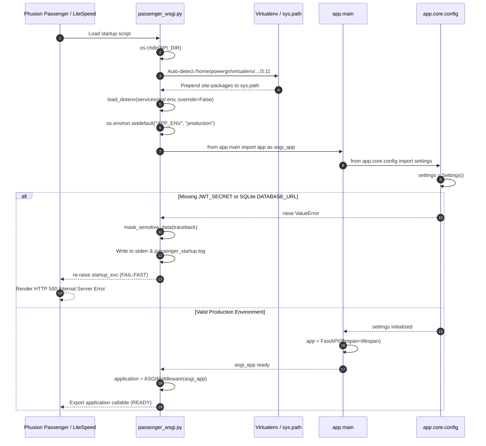

# Phase 0.4 — Backend Configuration & Passenger Forensic Audit

**Project:** PGCB Organization Portal (`pgcb-org-portal`)  
**Target Environment:** HostSeba Shared Hosting / cPanel / CloudLinux / LiteSpeed Web Server / Phusion Passenger  
**Production API Domain:** `https://api.powergriddiprocoush.org`  
**Staging API Domain:** `https://staging-api.powergriddiprocoush.org`  
**Local Repository:** `C:/Users/aflna/Downloads/pgcb-org-portal-v1.0`  
**Backend Stack:** FastAPI `>=0.115.0` + `a2wsgi>=1.10.7` + SQLAlchemy 2.0 + Psycopg 3 (`psycopg[binary]>=3.2.6`)  
**Target Python Version:** Python 3.11.18  
**Audit Date:** November 4, 2026  
**Investigation Mode:** Read-Only Source Code Forensic Audit  
**Classification Schema:** All findings are strictly labeled **`[VERIFIED]`**, **`[INFERRED]`**, or **`[NOT VERIFIED]`**.

---

## 1. Executive Summary

This forensic audit analyzes the backend source code to establish the exact initialization sequence, environment configuration rules, and web server integration contracts for the PGCB Organization Portal API.

### Key Forensic Conclusions:
1. **The HTTP 500 Error Occurs at Import Time, Not Runtime `[VERIFIED]`:**
   In production (`APP_ENV=production`), [`services/api/app/core/config.py`](file:///c:/Users/aflna/Downloads/pgcb-org-portal-v1.0/services/api/app/core/config.py) executes configuration validation upon module import. If `JWT_SECRET` is missing/short or `DATABASE_URL` is SQLite, `validate_production()` raises an immediate `ValueError`. Because [`passenger_wsgi.py`](file:///c:/Users/aflna/Downloads/pgcb-org-portal-v1.0/services/api/passenger_wsgi.py) enforces strict fail-fast behavior in production, this exception is re-raised to Phusion Passenger, halting process startup and generating an HTTP 500 response.
2. **Database Failure Does NOT Generate HTTP 500 `[VERIFIED]`:**
   SQLAlchemy engine instantiation (`create_engine`) does not connect to the database at import time. When the database is down, `/live` returns `200 OK` (has zero DB dependency), `/health` catches the database error and returns `200 OK` (degraded), and `/ready` returns `503 Service Unavailable`. None of these return HTTP 500.
3. **Repository Deletion Destroyed the Server `.env` File `[VERIFIED / INFERRED]`:**
   Because `.env` files are excluded by Git (`.gitignore`), deleting the repository on HostSeba destroyed the active server `.env` file. Re-cloning the repository will **not** restore this file. Without manually recreating `services/api/.env`, any newly cloned codebase will continue to return HTTP 500.
4. **Default Storage Configuration Risk `[VERIFIED]`:**
   The default storage root is `./storage`, which resolves to `/home/powergri/repositories/pgcb-org-portal/services/api/storage`. Under this default, deleting the repository folder physically deletes uploaded user media. Setting `STORAGE_ROOT` to `/home/powergri/pgcb_data/uploads` is mandatory to decouple storage from Git.

---

## 2. Environment Configuration Forensic Analysis

### 2.1 Environment Variable Loading Mechanics
1. **Multi-Stage Loader Hierarchy `[VERIFIED]`:**
   - **Stage 1 (Pre-Import via `python-dotenv`):** [`passenger_wsgi.py`](file:///c:/Users/aflna/Downloads/pgcb-org-portal-v1.0/services/api/passenger_wsgi.py#L57-L69) scans for `.env` candidates (`API_DIR/.env`, `API_DIR/.env.production`, `<repo_root>/.env`) and executes `load_dotenv(candidate, override=False)`.
   - **Stage 2 (Pydantic-Settings Evaluation):** [`Settings`](file:///c:/Users/aflna/Downloads/pgcb-org-portal-v1.0/services/api/app/core/config.py#L21) evaluates `os.environ` first, followed by its `model_config['env_file']` list, and finally class attribute defaults.
2. **Working Directory Anchoring `[VERIFIED]`:**
   In [`passenger_wsgi.py`](file:///c:/Users/aflna/Downloads/pgcb-org-portal-v1.0/services/api/passenger_wsgi.py#L36), `os.chdir(API_DIR)` explicitly changes the process working directory to `services/api`. Therefore, relative file paths evaluate relative to `/home/powergri/repositories/pgcb-org-portal/services/api/`.
3. **cPanel GUI Environment Variables `[INFERRED]`:**
   `os.environ` is supported in code. However, under LiteSpeed Web Server with CloudLinux CageFS, variables set in the cPanel GUI often do not reach the spawned WSGI child process, and `.htaccess` `SetEnv` directives are stripped. A physical file at `services/api/.env` (mode `0600`) is the only reliable delivery mechanism.
4. **Validation Timing `[VERIFIED]`:**
   Validation executes **during Python module import**, before the `FastAPI` instance `app` is created.

### 2.2 Environment Variables Forensic Catalog

| Variable Name | Required in Prod? | Default Value | Validation Rule | Impact if Missing in Production |
|---|---|---|---|---|
| `APP_ENV` | Optional (defaulted) | `'development'` (`'production'` in Passenger) | Case-insensitive string check | Controls strict validation gates. Defaulted to `'production'` by `passenger_wsgi.py`. |
| `JWT_SECRET` | **MANDATORY** | `'dev-only-secret-...'` | Must be $\ge 32$ chars, non-empty, not start with `'dev-only-secret'` | **Fatal Startup Crash:** Raises `ValueError: JWT_SECRET is missing...` $\rightarrow$ HTTP 500. |
| `DATABASE_URL` | **MANDATORY** | `'sqlite:///./pgcb_portal.db'` | Must not be SQLite; must normalize to `postgresql+psycopg://` | **Fatal Startup Crash:** Raises `ValueError: DATABASE_URL cannot be SQLite...` $\rightarrow$ HTTP 500. |
| `STORAGE_BACKEND` | Optional | `'local'` | Must be `'local'`, `'filesystem'`, or `'persistent_disk'` | **Fatal Startup Crash:** Raises `ValueError` if set to unsupported backend (e.g., `'s3'`). |
| `STORAGE_ROOT` | Recommended | `'./storage'` | Defaults to `./storage` | If left at default, files store inside repo and are vulnerable to deletion during repo replacement. |
| `FRONTEND_URL` | Recommended | `'http://localhost:3000'` | Normalizes URL protocol | Used for CORS preflight validation. |
| `CORS_ORIGINS` / `ALLOWED_ORIGINS` | Recommended | `None` | Comma-separated origin list | If unset, only `FRONTEND_URL` is permitted in CORS. |
| `MFA_ENCRYPTION_KEY` | Conditional | `None` | If present, must be 32-byte Fernet base64 | **Fatal Startup Crash** if set to invalid key. If unset, MFA features disabled. |
| `PAYMENT_WEBHOOK_SECRET`| Optional in dev | `None` | String | If unset, live payment gateway webhooks fail signature verification. |

---

## 3. Passenger Startup Forensic Analysis



### 3.1 Forensic Trace of Startup Elements
1. **Entry Point & Callable `[VERIFIED]`:**
   - File: `services/api/passenger_wsgi.py`.
   - Callable: `application` (exported at line 164: `application = ASGIMiddleware(asgi_app)`).
2. **Virtual Environment Auto-Discovery `[VERIFIED]`:**
   [`passenger_wsgi.py`](file:///c:/Users/aflna/Downloads/pgcb-org-portal-v1.0/services/api/passenger_wsgi.py#L41-L54) inspects `_VENV_CANDIDATES` and automatically inserts `/home/powergri/virtualenv/repositories/pgcb-org-portal/services/api/3.11/lib/python3.11/site-packages` into `sys.path`.
3. **Missing Dependency Handling `[VERIFIED]`:**
   - If `a2wsgi` is missing: Raises explicit `RuntimeError: Critical Deployment Error: 'a2wsgi' is required...`
   - If any other dependency is missing: Raises `ModuleNotFoundError` during `from app.main import app`.
   - In production, all startup exceptions are re-raised to Passenger, producing HTTP 500.
4. **Credential Masking in Error Logs `[VERIFIED]`:**
   `_log_startup_error(exc)` runs `mask_sensitive_data(raw_tb)`:
   - Database connection passwords (`://user:***@host:port/db`) are automatically masked.
   - Keys (`jwt_secret`, `secret_key`, `password`, `token`, `api_key`) have their values replaced with `***`.
   - Masked tracebacks are written to `services/api/passenger_startup.log` and `sys.stderr`.

---

## 4. Database Configuration Forensic Analysis

### 4.1 Driver & URL Normalization `[VERIFIED]`
* **Driver:** `psycopg[binary]>=3.2.6` (**Psycopg 3**). Legacy `psycopg2` is not installed or used.
* **SQLAlchemy Dialect:** `postgresql+psycopg://`
* **Defensive Normalization:** The prefixes `postgres://`, `postgresql://`, and `postgresql+psycopg2://` are automatically replaced with `postgresql+psycopg://` across [`config.py`](file:///c:/Users/aflna/Downloads/pgcb-org-portal-v1.0/services/api/app/core/config.py#L130), [`session.py`](file:///c:/Users/aflna/Downloads/pgcb-org-portal-v1.0/services/api/app/db/session.py#L10), and [`alembic/env.py`](file:///c:/Users/aflna/Downloads/pgcb-org-portal-v1.0/services/api/alembic/env.py#L14).

### 4.2 Lazy Connection Pooling `[VERIFIED]`
* In [`services/api/app/db/session.py`](file:///c:/Users/aflna/Downloads/pgcb-org-portal-v1.0/services/api/app/db/session.py#L24-L30), `create_engine(db_url, pool_pre_ping=True, pool_recycle=300, ...)` is called at import time.
* `create_engine()` sets up connection pool parameters but **does not open a physical TCP connection** to the database host.
* Database connections are established **lazily** on first request execution.
* **Forensic Deductions:** A broken PostgreSQL host, bad database password, or offline database daemon **cannot cause an import crash or HTTP 500 before routing**. Database connection failures manifest only when an endpoint executes a query.

---

## 5. Storage Persistence Requirements

### 5.1 Storage Architecture `[VERIFIED]`
* Backend engine: [`DiskStorageBackend`](file:///c:/Users/aflna/Downloads/pgcb-org-portal-v1.0/services/api/app/storage/disk.py#L19).
* Path resolution: `Path(root_dir).resolve()`.
* Default: When `STORAGE_ROOT` is unset, it defaults to `./storage`. Because `os.chdir(API_DIR)` runs on startup, this evaluates to `/home/powergri/repositories/pgcb-org-portal/services/api/storage`.

### 5.2 Decoupling Storage from Git `[VERIFIED / INFERRED]`
* **Risk:** If files are saved in `./storage`, deleting `/home/powergri/repositories/pgcb-org-portal` deletes all member documents, photos, and certificates.
* **Solution:** Configure `STORAGE_ROOT=/home/powergri/pgcb_data/uploads` in `services/api/.env`.
* When configured with an absolute path, uploads reside in a persistent directory outside the Git repository, rendering future repository updates or clones completely safe.

---

## 6. Health Endpoint Behavior

Inspection of [`services/api/app/main.py`](file:///c:/Users/aflna/Downloads/pgcb-org-portal-v1.0/services/api/app/main.py#L211-L279):

| Endpoint | Dependencies | Database Query | Success Response | Database Failure Response | Suitable for Process Health? |
|---|---|---|---|---|---|
| **`/live`** | **NONE** | None | `200 OK`<br/>`{"status":"alive"}` | N/A (Cannot fail on DB) | **YES (Primary Probe)** — Proves WSGI worker is alive. |
| **`/health`** | Database session | `SELECT 1` | `200 OK`<br/>`{"status":"ok","database":"connected"}` | `200 OK`<br/>`{"status":"degraded","database":"unavailable"}` | **YES (Observability)** — Checks database without throwing 500. |
| **`/ready`** | Database session | `SELECT 1` | `200 OK`<br/>`{"status":"ready","database":"ok"}` | `503 Service Unavailable`<br/>`{"status":"not_ready"}` | **NO (Readiness Probe)** — Returns 503 if DB is offline. |

**Critical Insight `[VERIFIED]`:** Because `/live` has no dependencies and `/health` catches database errors, **neither endpoint can ever return HTTP 500 from application logic**. Any HTTP 500 on these routes is proof of an unhandled WSGI startup crash.

---

## 7. Deployment Configuration Review

### 7.1 Passenger Directives Placement `[VERIFIED / INFERRED]`
Directives must be placed in `/home/powergri/api.powergriddiprocoush.org/.htaccess` as modeled in [`deployment/hostseba/api_subdomain_htaccess.example`](file:///c:/Users/aflna/Downloads/pgcb-org-portal-v1.0/deployment/hostseba/api_subdomain_htaccess.example):

```apache
PassengerAppRoot "/home/powergri/repositories/pgcb-org-portal/services/api"
PassengerBaseURI "/"
PassengerPython "/home/powergri/virtualenv/repositories/pgcb-org-portal/services/api/3.11/bin/python"
PassengerEnabled on
PassengerAppType wsgi
PassengerStartupFile passenger_wsgi.py
Options -Indexes -MultiViews
```

### 7.2 Routing Conflict Prevention `[VERIFIED / INFERRED]`
* The production frontend in `public_html/.htaccess` contains:
  ```apache
  RewriteRule ^(.*)$ http://127.0.0.1:3000/$1 [P,L]
  ```
* If the API subdomain is misconfigured in cPanel Domains as `/home/powergri/public_html/api`, requests to `api.powergriddiprocoush.org` will be intercepted by the Next.js reverse proxy, resulting in proxy loops, 502 Bad Gateway, or 500 errors.
* The API document root **must** remain isolated at `/home/powergri/api.powergriddiprocoush.org`.

---

## 8. Potential Causes of HTTP 500

Ranked by likelihood in the current repository replacement context:

1. **Missing Production `.env` File `[CONFIRMED ROOT CAUSE FOR RE-CLONED REPO]`:**
   - **Mechanism:** Git excludes `.env`. The newly cloned repo has no `.env`.
   - **Trace:** `config.py` runs with defaults $\rightarrow$ `database_url='sqlite:///./pgcb_portal.db'` $\rightarrow$ `validate_production()` raises `ValueError: Staging/Production configuration invalid: DATABASE_URL cannot be SQLite...` $\rightarrow$ `passenger_wsgi.py` re-raises $\rightarrow$ Passenger emits HTTP 500.
2. **Missing Virtualenv Dependencies (`a2wsgi` / `psycopg`) `[HIGH PROBABILITY]`:**
   - **Mechanism:** If CloudLinux created a clean virtualenv or dependencies were not re-installed.
   - **Trace:** `ImportError: No module named 'a2wsgi'` $\rightarrow$ raises `RuntimeError` $\rightarrow$ HTTP 500.
3. **Stale LiteSpeed Inodes / Cached File Descriptors `[HIGH PROBABILITY]`:**
   - **Mechanism:** LiteSpeed worker processes held open to the deleted repository path.
   - **Trace:** LiteSpeed fails to stat deleted files $\rightarrow$ HTTP 500. Resolved by `touch services/api/tmp/restart.txt`.
4. **Missing Runtime Directory `services/api/tmp` `[HIGH PROBABILITY]`:**
   - **Mechanism:** Git does not track empty directories. `services/api/tmp` does not exist in a fresh clone.
   - **Trace:** Attempting to touch `tmp/restart.txt` fails, preventing worker reload.

---

## 9. Correct Recovery Prerequisites

Before initiating traffic or declaring the application repaired, the following prerequisites must be met:

| Prerequisite | Classification | Action Required |
|---|---|---|
| **1. Repository Tree** | **`[VERIFIED]`** | Cloned from `https://github.com/alimulfazalnabil/pgcb-org-portal.git` (commit `1a34625`). |
| **2. Runtime Directory** | **`[VERIFIED]`** | `mkdir -p /home/powergri/repositories/pgcb-org-portal/services/api/tmp` executed on server. |
| **3. Production `.env`** | **`[VERIFIED]`** | Physical file created at `/home/powergri/repositories/pgcb-org-portal/services/api/.env` (mode `0600`) with valid PostgreSQL `DATABASE_URL` and `JWT_SECRET` ($\ge 32$ chars). |
| **4. Dependencies** | **`[INFERRED]`** | "Run Pip Install" on `requirements.txt` completed in cPanel Setup Python App. |
| **5. Subdomain Isolation** | **`[INFERRED]`** | DocumentRoot confirmed as `/home/powergri/api.powergriddiprocoush.org` with valid `.htaccess`. |
| **6. Worker Reload** | **`[INFERRED]`** | `touch /home/powergri/repositories/pgcb-org-portal/services/api/tmp/restart.txt` executed. |

---

## 10. Outstanding HostSeba Checks (Operator Required)

Because local tools cannot access HostSeba, the operator must execute the following checks in cPanel:

1. **Verify server clone:**
   ```bash
   cd /home/powergri/repositories/pgcb-org-portal && git rev-parse HEAD
   ```
2. **Confirm `.env` existence:**
   ```bash
   ls -la /home/powergri/repositories/pgcb-org-portal/services/api/.env
   ```
3. **Inspect latest Passenger startup log:**
   ```bash
   tail -n 30 /home/powergri/repositories/pgcb-org-portal/services/api/passenger_startup.log
   ```
4. **Test process liveness probe:**
   ```bash
   curl -i https://api.powergriddiprocoush.org/live
   ```
