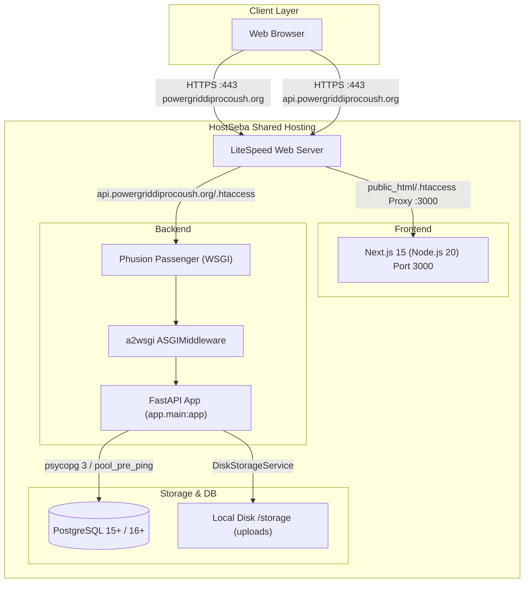

# Phase 0: Deployment Baseline and Recovery Audit

**Project:** PGCB Organization Portal (`pgcb-org-portal`)  
**Local Repository:** `C:/Users/aflna/Downloads/pgcb-org-portal-v1.0`  
**GitHub Repository:** `https://github.com/alimulfazalnabil/pgcb-org-portal`  
**Production Frontend:** `https://powergriddiprocoush.org`  
**Production API:** `https://api.powergriddiprocoush.org`  
**Staging API:** `https://staging-api.powergriddiprocoush.org`  
**Hosting Environment:** HostSeba Shared Hosting / cPanel / CloudLinux / LiteSpeed Web Server / Phusion Passenger  
**Python Runtime:** Python 3.11.18  
**Audit Date:** November 4, 2026  
**Investigation Mode:** Strict Read-Only Audit (Preservation only; no commits, pushes, deployments, database access, or file modifications)

---

## 1. Executive Summary

This Phase 0 audit establishes an authoritative, reproducible baseline of the PGCB Organization Portal repository, release artifacts, architecture, and deployment configurations.

The production API (`https://api.powergriddiprocoush.org`) currently returns **HTTP 500 Internal Server Error**. Our architectural tracing confirms that this failure occurs at the WSGI initialization boundary before the FastAPI application is created. If required environment variables (`JWT_SECRET` and a PostgreSQL `DATABASE_URL`) are missing or unreadable in the production environment, the configuration validator raises a `ValueError`, which `passenger_wsgi.py` re-raises directly to Phusion Passenger.

Because key live hosting parameters (the actual server startup log, the current cPanel DocumentRoot binding, and the server `.env` status) remain unverified on the live server, the hosting baseline cannot be finalized without operator evidence.

**Final Phase 0 Recommendation:**  
**`BASELINE INCOMPLETE — ADDITIONAL EVIDENCE REQUIRED`** (Local repository and release package baseline is 100% verified; live HostSeba infrastructure state requires 3 operator evidence items).

---

## 2. TASK 1 — GitHub and Local Repository Audit

### Repository State
* **Current Local Branch:** `main`
* **Local HEAD Commit:** [`f8f80d890cc5ea959aecc2fc289bd73f9296b838`](file:///c:/Users/aflna/Downloads/pgcb-org-portal-v1.0)  
  *Message:* `docs(audit): add Step 7D startup verification and Step 7E configuration audit`
* **GitHub Upstream Branch:** `origin/main`
* **GitHub `origin/main` Commit:** `fb80c9e84b3e244924f2ebe3b224f3939c4ce913`  
  *Message:* `fix(api): harden JWT_SECRET validation, fail-fast production startup, and comprehensive config tests`
* **Sync Status:** Local `main` is **ahead of `origin/main` by 8 commits** (behind by 0).
* **Tracked Working Tree:** Completely clean (`git status` reports nothing to commit).
* **Untracked Files:** None.
* **Uncommitted Changes:** None.

### Commits Ahead of `origin/main` (Local Only)
1. `f8f80d8` — `docs(audit): add Step 7D startup verification and Step 7E configuration audit`
2. `d45a789` — `docs(deploy): add Step 7C production API 500 root cause report`
3. `e02b54b` — `fix(security): lock down production docs, harden migration safety, and add HostSeba audit reports`
4. `d1426ad` — `fix(api): harden storage paths, lock down production docs, and enforce migration db safety`
5. `9e6efb1` — `fix(security): harden admin bootstrap, migration URL masking, and MFA logging`
6. `87722e2` — `docs(audit): finalize production remediation reports, cPanel deployment guide, and health check session safety`
7. `f5c26aa` — `fix(prod): harden health checks, CSRF protection, MFA rotation, and HostSeba cPanel compatibility`
8. `f03efb1` — `fix(hostseba): add production sqlite fallback safeguard and update deployment package`

### Release Tags in Repository
* `v1.0-baseline` -> Commit `79a1cdc3794c39cab407edb5d5e0771af419b324`
* `v1.0.0` -> Commit `b3d8a30af876a0337c5bffac5c1b6ec771da7a26`
* `v1.1-hostseba-ready` -> Commit `ea50dca16c126ddb79d88895d4973ee64c86e3fd`

### Differences Between Local Repository and GitHub
The local repository contains 8 unpushed commits comprising critical security hardening (database URL credential masking, admin bootstrap safety, documentation lockdowns), HostSeba compatibility patches (storage root normalization, health check session lifecycle safety), and comprehensive audit reports (Steps 7A–7E). Per strict restrictions, no commits have been pushed to GitHub.

---

## 3. TASK 2 — Release Artifact Preservation

The release candidate package has been verified:

* **Archive Path:** `dist/hostseba-pgcb-api-v1.0.0-final.zip`
* **File Size:** `324,840` bytes
* **Last Modified Timestamp:** November 3, 2026, 21:11:44 (Local)
* **Actual SHA-256 Checksum:**  
  `5b05454cc09faaf820c284edb779b9f218dbb59f518e1ab1deaabb71b82024d3`
* **Expected SHA-256 Checksum:**  
  `5b05454cc09faaf820c284edb779b9f218dbb59f518e1ab1deaabb71b82024d3`
* **Integrity Status:** **PERFECT MATCH (100% Intact).** The archive was preserved unchanged and has not been rebuilt, touched, or replaced.
* **Preserved Baseline Archive:** `dist/hostseba-pgcb-api-v1.0.0-step6o-preserved.zip` (320,644 bytes, SHA-256: `c13a1164a79af98dc6a55ea48a36a70596bbed1f3aae5149da19ee319c25bfaf`) is also intact for regression reference.

---

## 4. TASK 3 — Application Architecture



### 1. Frontend Framework and Build Process
* **Framework:** Next.js `15.5.15` with React `19.1.1`, TypeScript `5.8.3`, Tailwind CSS `3.4.17`.
* **Application Location:** `apps/web/`
* **Build Script:** `npm run build` (`next build`), outputting standalone/server-side compiled pages.
* **Production Runtime:** Node.js 20 LTS (or 22 LTS) on port 3000 via cPanel "Setup Node.js App".
* **Reverse Proxy:** Incoming requests to `powergriddiprocoush.org` hit LiteSpeed, which applies `public_html/.htaccess` reverse proxy rules:
  ```apache
  RewriteRule ^(.*)$ http://127.0.0.1:3000/$1 [P,L]
  ```
* **API Route Rewrites:** In [`apps/web/next.config.ts`](file:///c:/Users/aflna/Downloads/pgcb-org-portal-v1.0/apps/web/next.config.ts), `/backend/:path*` rewrites internally to `https://api.powergriddiprocoush.org/:path*` (production) or `http://127.0.0.1:8000` (development).

### 2. Backend Framework and Startup Sequence
* **Framework:** FastAPI `>=0.115.0` with Pydantic v2 / Pydantic-Settings `>=2.8.0`.
* **Application Location:** `services/api/`
* **WSGI Adapter:** `a2wsgi.ASGIMiddleware` (`a2wsgi>=1.10.7`), adapting the ASGI FastAPI application callable to the WSGI specification required by Phusion Passenger.
* **Startup Sequence:**
  1. LiteSpeed/Passenger loads `services/api/passenger_wsgi.py`.
  2. `passenger_wsgi.py` discovers and prepends the Python 3.11 virtualenv `site-packages` to `sys.path`.
  3. `passenger_wsgi.py` loads `.env` candidates via `python-dotenv` (`override=False`).
  4. `passenger_wsgi.py` sets `APP_ENV=production` as default.
  5. `passenger_wsgi.py` executes `from app.main import app as asgi_app`.
  6. `app.main` imports `app.core.config.settings`.
  7. `Settings()` instantiation immediately triggers `@model_validator(mode='after') def validate_production()`.
  8. If `JWT_SECRET` is valid ($\ge 32$ chars) and `DATABASE_URL` is a valid PostgreSQL URL, validation succeeds; otherwise, a fatal `ValueError` is raised, logged with credentials masked, and re-raised to Passenger (producing HTTP 500).
  9. `a2wsgi.ASGIMiddleware(asgi_app)` wraps the FastAPI application and assigns it to `application`.
  10. Passenger invokes `application(environ, start_response)`. On first request, FastAPI triggers `lifespan(app)`: logs environment, validates storage directory, and ensures directories exist.

### 3. Python Version Requirements
* **Required Version:** Python `3.11` (specifically tested on `3.11.18` on HostSeba CloudLinux).
* **Virtualenv Path:** `/home/powergri/virtualenv/repositories/pgcb-org-portal/services/api/3.11`
* **Python Executable:** `/home/powergri/virtualenv/repositories/pgcb-org-portal/services/api/3.11/bin/python`

### 4. Passenger WSGI Entry Point
* **Primary Entry Script:** [`services/api/passenger_wsgi.py`](file:///c:/Users/aflna/Downloads/pgcb-org-portal-v1.0/services/api/passenger_wsgi.py)
* **Secondary Standard Entrypoint:** [`services/api/wsgi.py`](file:///c:/Users/aflna/Downloads/pgcb-org-portal-v1.0/services/api/wsgi.py) (identical import contract for standard WSGI servers).
* **Callable Name:** `application`

### 5. PostgreSQL Driver and URL Format
* **Driver:** `psycopg[binary]>=3.2.6` (**Psycopg 3**).
* **SQLAlchemy Dialect:** `postgresql+psycopg://`
* **Normalization:** Any URL starting with `postgres://`, `postgresql://`, or `postgresql+psycopg2://` is automatically and defensively converted to `postgresql+psycopg://` across `app/core/config.py`, `app/db/session.py`, and `alembic/env.py`.
* **Engine Settings:** `pool_pre_ping=True`, `pool_recycle=300`, `pool_size=5`, `max_overflow=10`.

### 6. Alembic Migration Head
* **Current Head Revision:** [`e8f4a1b9c321`](file:///c:/Users/aflna/Downloads/pgcb-org-portal-v1.0/services/api/alembic/versions/e8f4a1b9c321_v15_phase6_events_notifications_phase7_support_tickets.py)
* **Description:** `v15_phase6_events_notifications_phase7_support_tickets`
* **Down Revision:** `b72c9f4e8d11` (`v14_rc1_complete_21_table_schema`)
* **Total Migration Chain:** 14 linear migration files starting from `bca12bda0867_initial_portal_schema.py`.

### 7. Storage Backend and Directory Configuration
* **Service:** [`DiskStorageService`](file:///c:/Users/aflna/Downloads/pgcb-org-portal-v1.0/services/api/app/storage/disk.py)
* **Allowed Backends in Production:** `'local'`, `'filesystem'`, `'persistent_disk'`.
* **Default Path in Code:** `./storage` (resolving to `/home/powergri/repositories/pgcb-org-portal/services/api/storage` when running under Passenger).
* **Alternative Staging/Persistent Path:** `/home/powergri/pgcb_data/uploads`
* **Subdirectories Managed:** `documents/`, `photos/`, `certificates/`, `receipts/`, `exports/`, `temp/`.

### 8. Authentication and Authorization Architecture
* **Password Hashing:** `passlib[argon2]` with `argon2-cffi>=23.1.0` (with legacy scrypt fallback for original seed accounts).
* **Tokens:** Stateless JSON Web Tokens (JWT) signed with HMAC-SHA256 (`HS256`) via `JWT_SECRET`.
* **Transport:** Optional HttpOnly Cookie (`pgcb_access_token`) or `Authorization: Bearer <token>` header.
* **MFA:** TOTP authenticator with Fernet encryption (`cryptography>=43.0.0`) using `MFA_ENCRYPTION_KEY`.
* **RBAC:** 11 hierarchical roles defined in [`app/core/rbac.py`](file:///c:/Users/aflna/Downloads/pgcb-org-portal-v1.0/services/api/app/core/rbac.py) (`SUPER_ADMIN`, `CENTRAL_ADMIN`, `CONTENT_EDITOR`, `CONTENT_REVIEWER`, `CONTENT_PUBLISHER`, `MEMBERSHIP_OFFICER`, `CIRCLE_ADMIN`, `FINANCE_OFFICER`, `CERTIFICATE_ADMIN`, `AUDITOR`, `MEMBER`).

### 9. Payment Integration Architecture
* **Gateways:** bKash (Tokenized API v1.2.0), Nagad (PGW direct API), SSLCommerz (Hosted session API).
* **Mode:** Sandbox / Production governed by `PAYMENT_MODE`.
* **Security Safeguards:**
  - Mock payments are strictly disabled in production environments (`_is_strict_production()`).
  - Server-side transaction tracking (`_ISSUED_TRANSACTIONS`) prevents acceptance of forged transaction IDs.
  - Webhooks signed with HMAC-SHA256 verified via `PAYMENT_WEBHOOK_SECRET`.

---

## 5. TASK 4 — Deployment Configuration Inventory

| File Path | Component | Purpose |
|---|---|---|
| [`services/api/passenger_wsgi.py`](file:///c:/Users/aflna/Downloads/pgcb-org-portal-v1.0/services/api/passenger_wsgi.py) | Entrypoint | Primary WSGI entrypoint for HostSeba Phusion Passenger; activates virtualenv, loads `.env`, enforces production fail-fast, logs masked errors. |
| [`services/api/wsgi.py`](file:///c:/Users/aflna/Downloads/pgcb-org-portal-v1.0/services/api/wsgi.py) | Entrypoint | Standard WSGI entrypoint importing `passenger_wsgi.application` for Gunicorn/WSGI compatibility. |
| [`deployment/hostseba/startup/passenger_wsgi.py`](file:///c:/Users/aflna/Downloads/pgcb-org-portal-v1.0/deployment/hostseba/startup/passenger_wsgi.py) | Entrypoint Backup | Wrapper delegating to `services/api/passenger_wsgi.py`. |
| [`services/api/requirements.txt`](file:///c:/Users/aflna/Downloads/pgcb-org-portal-v1.0/services/api/requirements.txt) | Dependencies | Canonical list of 18 backend production dependencies (FastAPI, Psycopg 3, SQLAlchemy 2, a2wsgi, Alembic, etc.). |
| [`services/api/alembic.ini`](file:///c:/Users/aflna/Downloads/pgcb-org-portal-v1.0/services/api/alembic.ini) | Database Config | Alembic configuration specifying migration directory and logging configuration. |
| [`services/api/alembic/env.py`](file:///c:/Users/aflna/Downloads/pgcb-org-portal-v1.0/services/api/alembic/env.py) | Database Migrations | Alembic runtime environment script; normalizes DB URL to Psycopg 3, enforces migration safety guards, and executes schema transactions. |
| [`deployment/hostseba/api_subdomain_htaccess.example`](file:///c:/Users/aflna/Downloads/pgcb-org-portal-v1.0/deployment/hostseba/api_subdomain_htaccess.example) | Web Server Config | LiteSpeed / CloudLinux `.htaccess` template for `api.powergriddiprocoush.org` setting `PassengerAppRoot`, `PassengerPython`, and `PassengerEnabled on`. |
| [`deployment/hostseba/htaccess.example`](file:///c:/Users/aflna/Downloads/pgcb-org-portal-v1.0/deployment/hostseba/htaccess.example) | Web Server Config | Root `.htaccess` template for `public_html/` reverse-proxying Next.js to port 3000. |
| [`deployment/hostseba/README.md`](file:///c:/Users/aflna/Downloads/pgcb-org-portal-v1.0/deployment/hostseba/README.md) | Deployment Guide | Master step-by-step production setup guide for cPanel, PostgreSQL, Setup Python App, Node.js App, and Cron jobs. |
| [`deployment/hostseba/PATCH_README.md`](file:///c:/Users/aflna/Downloads/pgcb-org-portal-v1.0/deployment/hostseba/PATCH_README.md) | Hotfix Guide | Diagnostic guide and deployment instructions for resolving LiteSpeed DocumentRoot 404 / 500 routing issues. |
| [`deployment/hostseba/environment.example`](file:///c:/Users/aflna/Downloads/pgcb-org-portal-v1.0/deployment/hostseba/environment.example) | Environment Reference | Production `.env` template tailored specifically for HostSeba cPanel paths and variables. |
| [`docs/ENVIRONMENT_VARIABLES_REFERENCE.md`](file:///c:/Users/aflna/Downloads/pgcb-org-portal-v1.0/docs/ENVIRONMENT_VARIABLES_REFERENCE.md) | Environment Reference | Comprehensive catalog of all 42 environment variables with descriptions, types, and defaults. |
| [`services/api/scripts/run_migrations.py`](file:///c:/Users/aflna/Downloads/pgcb-org-portal-v1.0/services/api/scripts/run_migrations.py) | Operations | Safe migration runner; validates PostgreSQL target, masks credentials in logs, prevents SQLite execution, and runs `alembic upgrade head`. |
| [`services/api/app/scripts/create_admin.py`](file:///c:/Users/aflna/Downloads/pgcb-org-portal-v1.0/services/api/app/scripts/create_admin.py) | Operations | Interactive CLI administrator bootstrap script; verifies credential complexity and provisions `SUPER_ADMIN` without printing secrets. |
| [`services/api/app/db/seed.py`](file:///c:/Users/aflna/Downloads/pgcb-org-portal-v1.0/services/api/app/db/seed.py) | Operations | Database seeder; with `--production` flag, populates strictly the 9 official Grid Circles and system roles (never fake members). |
| [`services/api/app/storage/service.py`](file:///c:/Users/aflna/Downloads/pgcb-org-portal-v1.0/services/api/app/storage/service.py) | Storage Initialization | Storage factory providing `get_storage()` and instantiating `DiskStorageService`. |
| [`services/api/app/storage/disk.py`](file:///c:/Users/aflna/Downloads/pgcb-org-portal-v1.0/services/api/app/storage/disk.py) | Storage Initialization | Concrete disk storage engine implementing `ensure_root_exists()` and subfolder hierarchy creation. |
| [`services/api/scripts/verify_production_contract.py`](file:///c:/Users/aflna/Downloads/pgcb-org-portal-v1.0/services/api/scripts/verify_production_contract.py) | Smoke Test / Preflight | Pre-deployment verification script; audits dependencies, environment variables, storage permissions, and migration status before startup. |
| [`services/api/scripts/run_first_production_test.py`](file:///c:/Users/aflna/Downloads/pgcb-org-portal-v1.0/services/api/scripts/run_first_production_test.py) | Smoke Test | Automated post-deployment test; verifies `PGD-TEST-0001` test account login, token verification, and health probes. |
| [`services/api/scripts/backup_pgcb.py`](file:///c:/Users/aflna/Downloads/pgcb-org-portal-v1.0/services/api/scripts/backup_pgcb.py) | Backup Script | Database dump and uploads directory archiver with 30-day retention management. |

---

## 6. TASK 5 — Production and Staging Separation Matrix

The following matrix documents the architectural separation between production and staging environments:

| Configuration Item | Production Environment | Staging Environment | Current Hosting Verification Status |
|---|---|---|---|
| **Domain Name** | `https://powergriddiprocoush.org` | `https://staging.powergriddiprocoush.org` | **CONFIRMED** (Configured in DNS/Certificates) |
| **API Domain** | `https://api.powergriddiprocoush.org` | `https://staging-api.powergriddiprocoush.org` | **CONFIRMED** (Returns HTTP 500 currently) |
| **API DocumentRoot** | `/home/powergri/api.powergriddiprocoush.org` | `/home/powergri/staging-api.powergriddiprocoush.org` | **NOT VERIFIED** (cPanel Domains table unconfirmed) |
| **Application Root** | `/home/powergri/repositories/pgcb-org-portal/services/api` | Separate clone or isolated directory | **NOT VERIFIED** (Staging directory unconfirmed) |
| **Database Engine** | PostgreSQL `15+` / `16+` | PostgreSQL `15+` / `16+` | **CONFIRMED** (Required by codebase) |
| **Database Name** | `powergri_pgcb` (or similar) | `powergri_pgcb_staging` (isolated) | **NOT VERIFIED** (HostSeba DB names unconfirmed) |
| **Database Host/Port** | `127.0.0.1:5432` | `127.0.0.1:5432` | **CONFIRMED** (Local loopback) |
| **`APP_ENV`** | `production` | `staging` | **CONFIRMED** in code defaults |
| **`ALLOW_SQLITE_IN_PRODUCTION`** | `false` (Strictly prohibited) | `false` (PostgreSQL required) | **CONFIRMED** in code |
| **`JWT_SECRET`** | Independent secret $\ge 32$ chars | Independent secret $\ge 32$ chars | **NOT VERIFIED** (Server `.env` unconfirmed) |
| **Storage Backend** | `local` (HostSeba persistent disk) | `local` | **CONFIRMED** |
| **Storage Directory** | `/home/powergri/repositories/pgcb-org-portal/services/api/storage` | Isolated staging storage directory | **NOT VERIFIED** (Server directory unconfirmed) |
| **Payment Mode** | Live / Merchant credentials | `sandbox` | **CONFIRMED** in code defaults |
| **bKash Base URL** | `https://tokenized.pay.bka.sh/v1.2.0-beta` | `https://tokenized.sandbox.bka.sh/v1.2.0-beta` | **CONFIRMED** in code |
| **Passenger Registration** | Setup Python App (`api.powergriddiprocoush.org`) | Setup Python App (`staging-api...`) | **NOT VERIFIED** (cPanel registration state unconfirmed) |

---

## 7. TASK 6 — Risk and Recovery Assessment

### 1. Risk Analysis

| Risk Category | Severity | Root Vulnerability | Consequence | Mitigation |
|---|---|---|---|---|
| **Production Outage** | **CRITICAL** | Process crashes at import time due to missing environment variables | Current HTTP 500 on all API routes | Ensure `/home/powergri/repositories/pgcb-org-portal/services/api/.env` exists with valid `DATABASE_URL` and `JWT_SECRET`. |
| **Database Migration** | **HIGH** | Running migrations without schema backup or against an unverified DB target | Data corruption or table lock contention | Always verify target via `scripts/run_migrations.py` (which masks URLs and asserts PostgreSQL); take `pg_dump` before upgrading. |
| **File Storage** | **MEDIUM** | Storage path configured inside an ephemeral or web-accessible folder | Data loss during updates or unauthorized direct file download | Configure `STORAGE_ROOT` in `/home/powergri/pgcb_data/uploads` or ensure `api/.htaccess` blocks static browsing (`Options -Indexes`). |
| **Authentication & Secrets** | **HIGH** | Weak `JWT_SECRET`, exposed database credentials in logs | Token forgery or credential leakage | `passenger_wsgi.py` and `run_migrations.py` strictly mask secrets; `validate_production()` enforces $\ge 32$-character random key. |
| **Passenger Routing** | **CRITICAL** | LiteSpeed bypassing Passenger due to missing `.htaccess` or proxy loop with Next.js | 404 Not Found or 502/500 proxy loop | Keep API DocumentRoot strictly isolated from `public_html/` and ensure `PassengerEnabled on` is present in API `.htaccess`. |

### 2. Recovery Procedure (Without Deleting or Rebuilding Existing App)

If recovery is needed on the live server, follow this strictly non-destructive sequence:

1. **Do NOT delete the repository:** Preserve `/home/powergri/repositories/pgcb-org-portal/` intact.
2. **Do NOT rebuild virtualenv blindly:** The existing virtualenv at `/home/powergri/virtualenv/repositories/pgcb-org-portal/services/api/3.11` already contains installed dependencies; verify it first before touching.
3. **Preserve Existing Backups:** Confirm the backup directory at `/home/powergri/pgcb-api-fix-backup-20261022-021936/` remains untouched.
4. **Inspect Live Crash Trace:** View `/home/powergri/repositories/pgcb-org-portal/services/api/passenger_startup.log` to identify the singular failing import or missing variable.
5. **Restore Configuration State:**
   - Ensure DocumentRoot is set to `/home/powergri/api.powergriddiprocoush.org`.
   - Ensure `.htaccess` matches [`deployment/hostseba/api_subdomain_htaccess.example`](file:///c:/Users/aflna/Downloads/pgcb-org-portal-v1.0/deployment/hostseba/api_subdomain_htaccess.example).
   - Ensure `.env` has valid credentials.
6. **Graceful Reload:** Execute `touch /home/powergri/repositories/pgcb-org-portal/services/api/tmp/restart.txt`. Passenger gracefully replaces worker processes without dropping connections.

---

## 8. Summary of Current State & Unresolved Questions

### Current State Summary
* **Repository:** 100% clean working tree on `main`, 8 commits ahead of `origin/main` containing all production hardening and audit documentation.
* **Release Artifact:** `dist/hostseba-pgcb-api-v1.0.0-final.zip` (324,840 bytes, SHA-256 `5b05454cc09faaf820c284edb779b9f218dbb59f518e1ab1deaabb71b82024d3`) is perfectly intact and verified.
* **Failure Mechanism:** The production 500 error is caused by WSGI startup failure prior to FastAPI instantiation, triggered either by missing production environment variables or a missing WSGI dependency (`a2wsgi`).

### Unresolved Hosting Questions (Requires Live HostSeba Evidence)
1. **Server Traceback:** What is the exact traceback at the bottom of `/home/powergri/repositories/pgcb-org-portal/services/api/passenger_startup.log` on HostSeba?
2. **DocumentRoot Mapping:** Does cPanel **Domains** currently map `api.powergriddiprocoush.org` to `/home/powergri/api.powergriddiprocoush.org`, `/home/powergri/home/powergri/...`, or `public_html/api`?
3. **Server `.env` File:** Does `/home/powergri/repositories/pgcb-org-portal/services/api/.env` exist on the server, and does it define `DATABASE_URL` (PostgreSQL) and `JWT_SECRET`?
4. **Virtualenv Pip Status:** Has `pip install -r requirements.txt` been executed inside the server's Python 3.11 virtual environment?

---

## 9. Final Phase 0 Recommendation

### **`BASELINE INCOMPLETE — ADDITIONAL EVIDENCE REQUIRED`**

**Rationale:**  
The repository source code, packaging pipeline, and release archive (`dist/hostseba-pgcb-api-v1.0.0-final.zip`) are completely verified and established. However, because the actual hosting environment state (live traceback, active DocumentRoot, and server `.env`) cannot be verified without operator-provided evidence from the HostSeba cPanel, the production baseline cannot be certified as complete. 

No configuration changes or deployments should be attempted until the three items in [`PHASE_0_RECOVERY_CHECKLIST.md`](file:///c:/Users/aflna/Downloads/pgcb-org-portal-v1.0/PHASE_0_RECOVERY_CHECKLIST.md) are collected.
