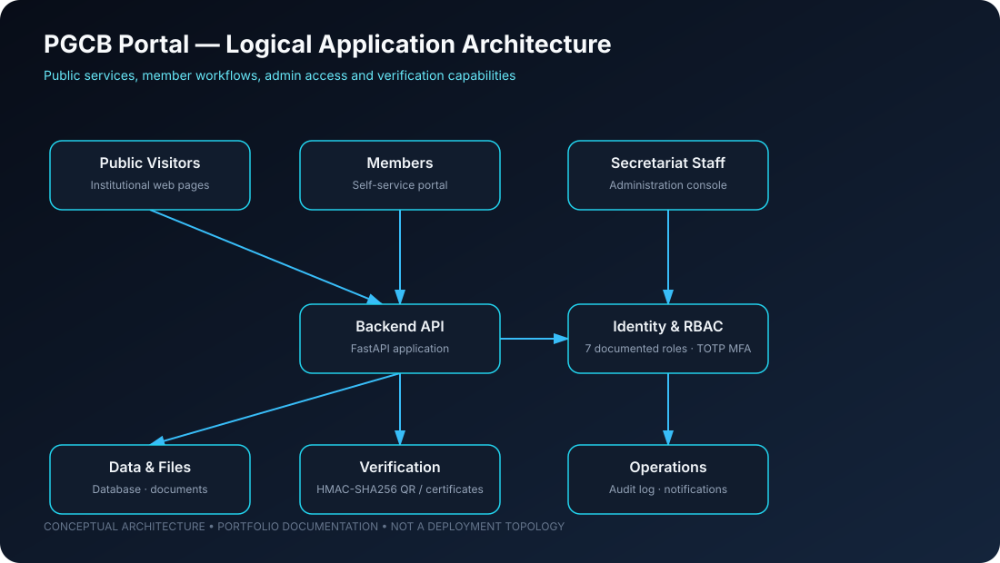

# PGCB Organization Portal

### Institutional web platform · Member self-service · Secure credential verification

**Engineering focus:** Full-stack delivery · Identity and access control · Verification workflows · Deployment and operations

---

## 01 — Project overview

The **PGCB Organization Portal** is an institutional web portal and member self-service platform for the Power Grid Diploma Engineers Association (PGCB), affiliated with IDEB.

The platform brings public institutional information, membership workflows, digital credential verification and secretariat administration into a unified application.

**Live portal:** [pgcb-org-portal.onrender.com](https://pgcb-org-portal.onrender.com/)

## 02 — Platform capabilities

### Public institutional website

The public site is documented as a Bangla-first, bilingual (Bangla and English) experience with dark/light mode support. Its information architecture includes:

- About, committee and committee messages
- Membership overview, benefits, application and tracking
- Events and registration
- Circulars, notices and documents
- Technical journal, media gallery and search
- Contact information

### Member self-service

Authenticated members can access:

- Member dashboard
- Digital member ID card
- QR verification badge
- Document uploads
- Event registrations
- In-app notifications

### Credential and certificate verification

The portal documents verification flows for:

- Digital member ID cards using a member ID or HMAC-SHA256 signed QR token
- Digital certificates, including verification and PDF download

### Secretariat administration

The administration console documents 21 specialised subroutes and a seven-role permission matrix:

| Role | Intended access domain |
|---|---|
| SUPER_ADMIN | Platform administration |
| CONTENT_EDITOR | Institutional content |
| MEMBERSHIP_OFFICER | Membership operations |
| CIRCLE_ADMIN | Circle-level administration |
| FINANCE_OFFICER | Finance workflows |
| AUDITOR | Audit and review |
| MEMBER | Member self-service |

The documented security controls include TOTP multi-factor authentication and immutable audit logging. Review the security and RBAC documentation for implementation details and limitations.

## 03 — Application architecture

~~~mermaid
flowchart TB
    VISITOR["Public visitors"] --> WEB["Public web application"]
    MEMBER["Authenticated members"] --> WEB
    STAFF["Secretariat staff"] --> ADMIN["Admin console"]
    WEB --> API["Backend API"]
    ADMIN --> API
    API --> AUTH["Authentication / RBAC"]
    AUTH --> SERVICES["Membership, events, content and verification services"]
    SERVICES --> DB[("Relational database")]
    SERVICES --> FILES[("Document / media storage")]
    SERVICES --> QR["HMAC-SHA256 QR verification"]
    SERVICES --> MFA["TOTP MFA"]
    API --> AUDIT["Audit logging"]
    API --> NOTIFY["In-app notifications"]
~~~

The diagram is a logical view of documented capabilities. It does not expose deployment secrets, production network boundaries or a complete infrastructure topology.

## 04 — Engineering and security highlights

- **Role-based access control:** Seven documented roles for separating member, staff and administrative permissions.
- **Credential verification:** HMAC-SHA256 signed QR token verification for member identity workflows.
- **Multi-factor authentication:** TOTP MFA documented for administrative access.
- **Auditability:** Immutable audit logging is documented as an administrative control.
- **Data workflows:** Membership applications, tracking, document upload and event registration.
- **Operational documentation:** Architecture, database, RBAC, security, testing and deployment guides are maintained in the docs directory.

These are repository-documented capabilities. A live URL alone is not an independent security audit or guarantee of uninterrupted service.

## 05 — Documentation map

| Document | Purpose |
|---|---|
| [System architecture](docs/ARCHITECTURE.md) | Application architecture |
| [Database](docs/DATABASE.md) | Schema and migrations |
| [RBAC](docs/RBAC.md) | Role and permission model |
| [Security](docs/SECURITY.md) | Security architecture |
| [Deployment](docs/DEPLOYMENT.md) | Deployment and operations |
| [Testing](docs/TESTING.md) | Testing and verification |
| [Project audit](docs/PROJECT_AUDIT.md) | Audit and gap analysis |
| [Completeness matrix](docs/COMPLETENESS_MATRIX.md) | Feature status overview |

## 06 — Local development

### Backend API

~~~bash
cd services/api
python -m venv .venv

# Windows
.venv\Scripts\activate

# Linux / macOS
source .venv/bin/activate

pip install -r requirements.txt
alembic upgrade head
uvicorn app.main:app --reload --port 8000
~~~

### Frontend web application

~~~bash
cd apps/web
npm install
npm run dev
~~~

Open the local frontend at http://localhost:3000 when running with the documented development configuration.

> **Administrator bootstrap:** The original project documentation includes a command to create a SUPER_ADMIN account. Use only a unique, strong local development password. Never reuse an example password in a deployed environment.

## 07 — Quality checks

The repository README documents the following checks:

~~~bash
# Backend tests
cd services/api
python -m pytest -v

# Frontend checks
cd apps/web
npm run typecheck
npm run lint
npm run build
~~~

The repository documentation reports a backend test suite of 61 tests. Re-run the suite against the current commit to confirm the present result; this README does not claim a fresh test execution.

## 08 — Deployment and operational review

Before a production release, review:

- Environment-specific configuration and secret management.
- Database backup and recovery procedures.
- Authentication, authorisation and session handling.
- QR verification key rotation and token expiry.
- TOTP recovery and administrator account recovery.
- Audit log retention and integrity.
- File upload validation and access control.
- Monitoring, alerting and incident response.

Deployment details are maintained in [docs/DEPLOYMENT.md](docs/DEPLOYMENT.md).

## 09 — Maintainer

**Alimul Fazal Nabil** — Cloud AI Platform Engineering | Infrastructure | Application Delivery

[GitHub](https://github.com/alimulfazalnabil) · [LinkedIn](https://www.linkedin.com/in/alimul-fazal-nabil/) · [Portfolio](https://alimulfazalnabil.github.io/)

---

*Portfolio project and deployed application. Feature descriptions reflect repository documentation; operational status, security posture and test results should be verified independently.*
