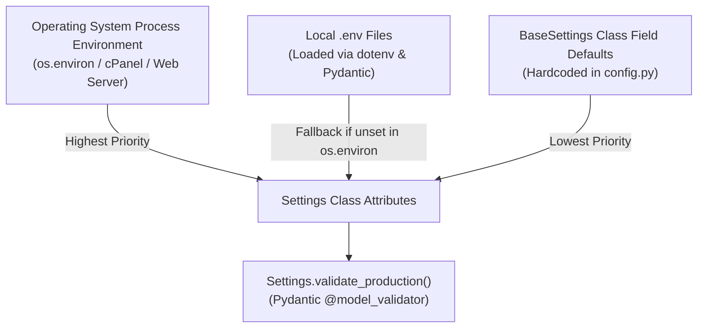
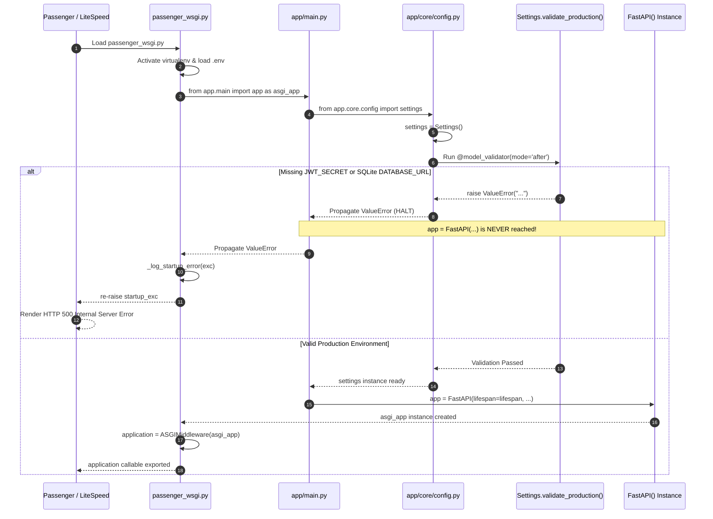
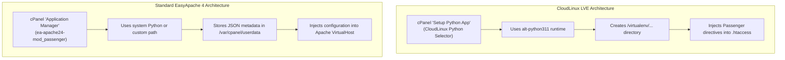
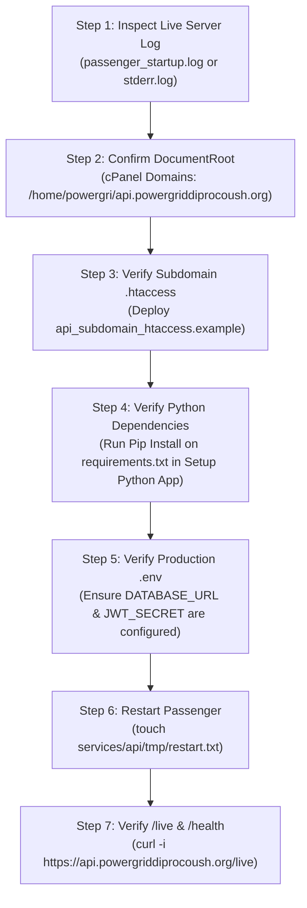

# Step 7E — Production Environment and Passenger Configuration Audit

**Project:** PGCB Organization Portal (`pgcb-org-portal`)  
**Target Environment:** HostSeba Shared Hosting / cPanel / CloudLinux / LiteSpeed Web Server / Phusion Passenger  
**Production API Domain:** `https://api.powergriddiprocoush.org`  
**Repository Working Directory:** `C:/Users/aflna/Downloads/pgcb-org-portal-v1.0`  
**Target Python Version:** 3.11.18  
**Audit Date:** November 4, 2026  
**Investigation Mode:** Strict Read-Only Audit (No production changes, no Git commits, no migrations, no database access)

---

## Executive Summary

This audit investigates the production runtime environment, environment variable propagation, and Phusion Passenger WSGI initialization sequence for the PGCB Organization Portal API. 

The investigation confirms that the live production HTTP 500 error on `https://api.powergriddiprocoush.org` is occurring **at the WSGI initialization boundary before the FastAPI application instance is created**. If required production environment variables (`JWT_SECRET` and a PostgreSQL `DATABASE_URL`) are missing or unreadable by the process, the application's configuration loader ([`app/core/config.py`](file:///c:/Users/aflna/Downloads/pgcb-org-portal-v1.0/services/api/app/core/config.py)) raises an immediate `ValueError`. Because `passenger_wsgi.py` enforces strict fail-fast behavior in production, this exception is re-raised to Passenger, terminating the process and returning an HTTP 500 error to the client.

---

## 1. Environment Variable Loading Mechanism

### Architecture & Precedence
The application utilizes Pydantic-Settings ([`BaseSettings`](file:///c:/Users/aflna/Downloads/pgcb-org-portal-v1.0/services/api/app/core/config.py#L21)) in conjunction with `python-dotenv` ([`passenger_wsgi.py`](file:///c:/Users/aflna/Downloads/pgcb-org-portal-v1.0/services/api/passenger_wsgi.py#L57-L69)). 

Environment variables are resolved in the following hierarchical order:



### Detailed Loading Mechanism
1. **Pre-Import Environment Loading ([`services/api/passenger_wsgi.py`](file:///c:/Users/aflna/Downloads/pgcb-org-portal-v1.0/services/api/passenger_wsgi.py#L57-L73)):**
   Prior to importing any application modules, `passenger_wsgi.py` attempts to import `dotenv.load_dotenv` and scans for `.env` candidates:
   ```python
   for env_candidate in (
       API_DIR / ".env",
       API_DIR / ".env.production",
       API_DIR.parent.parent / ".env",
       API_DIR.parent.parent / ".env.production",
   ):
       if env_candidate.is_file():
           load_dotenv(env_candidate, override=False)
   ```
   Setting `override=False` ensures that any variable already populated in the operating system environment (e.g., set by CloudLinux or the web server) is preserved.
2. **Environment Variable Fallback ([`passenger_wsgi.py`](file:///c:/Users/aflna/Downloads/pgcb-org-portal-v1.0/services/api/passenger_wsgi.py#L71)):**
   `passenger_wsgi.py` executes:
   ```python
   os.environ.setdefault("APP_ENV", "production")
   ```
   Under Passenger, `APP_ENV` is guaranteed to be `'production'` unless explicitly overridden in the environment.
3. **Pydantic Model Loading ([`services/api/app/core/config.py`](file:///c:/Users/aflna/Downloads/pgcb-org-portal-v1.0/services/api/app/core/config.py#L75-L84)):**
   The [`Settings`](file:///c:/Users/aflna/Downloads/pgcb-org-portal-v1.0/services/api/app/core/config.py#L21) class specifies:
   ```python
   model_config = SettingsConfigDict(
       env_file=(
           '.env',
           str(Path(__file__).resolve().parents[2] / '.env'),
           str(Path(__file__).resolve().parents[2] / '.env.production'),
           str(Path(__file__).resolve().parents[3] / '.env'),
           str(Path(__file__).resolve().parents[3] / '.env.production'),
       ),
       extra='ignore',
   )
   ```
   Pydantic reads from `os.environ` first, and if a field is not present in `os.environ`, it inspects the listed `.env` files in order.

---

## 2. Mandatory Production Environment Variables

When `APP_ENV` is `'production'` or `'staging'`, [`Settings.validate_production()`](file:///c:/Users/aflna/Downloads/pgcb-org-portal-v1.0/services/api/app/core/config.py#L90-L187) executes strict validation. The following variables are **mandatory**:

| Variable Name | Type / Requirement | Default in Code | Failure Condition in Production | Impact if Missing |
|---|---|---|---|---|
| `JWT_SECRET` | String, $\ge 32$ chars, random | `'dev-only-secret-...'` | Value is missing, starts with `'dev-only-secret'`, or `len < 32` | **Fatal Startup Crash:** Raises `ValueError: JWT_SECRET is missing or using the development placeholder...` |
| `DATABASE_URL` | PostgreSQL connection string | `'sqlite:///./pgcb_portal.db'` | Starts with `'sqlite'` or dialect is not `'postgresql+psycopg://'` | **Fatal Startup Crash:** Raises `ValueError: Staging/Production configuration invalid: DATABASE_URL cannot be SQLite...` |
| `STORAGE_BACKEND` | Must be `'local'`, `'filesystem'`, or `'persistent_disk'` | `'local'` | Value not in allowed tuple | **Fatal Startup Crash:** Raises `ValueError: Staging/Production storage configuration invalid...` |
| `MFA_ENCRYPTION_KEY` | 32-byte URL-safe base64 string | `None` | Set to a value that fails `cryptography.fernet.Fernet` instantiation | **Fatal Startup Crash:** Raises `ValueError: MFA_ENCRYPTION_KEY is invalid...` |

### Discrete Database Variables as Alternative
If `DATABASE_URL` is omitted, `Settings.validate_production()` can synthesize it if all three discrete variables are provided:
- `DB_HOST`: Hostname (e.g., `127.0.0.1` or `localhost`).
- `DB_USER`: Database user (e.g., `powergri_pgcb`).
- `DB_PASSWORD`: User password (URL-encoded).
- Optional: `DB_PORT` (default 5432), `DB_NAME` (default `'pgcb_portal'`), `DB_SSLMODE` (default `'prefer'`).

If neither a complete PostgreSQL `DATABASE_URL` nor the discrete database parameters are supplied, `Settings` retains the default SQLite URL, causing an immediate `ValueError` in production.

---

## 3. Environment Variable Source: `os.environ`, `.env`, or Both

### Finding: The application reads from **BOTH**, with `os.environ` taking precedence.

1. **Precedence Hierarchy:**
   - **Priority 1:** `os.environ` (Operating system environment variables).
   - **Priority 2:** `.env` files loaded by `python-dotenv` into `os.environ`.
   - **Priority 3:** `.env` files read directly by `pydantic-settings`.
   - **Priority 4:** Class-level default values in `Settings`.

2. **Crucial LiteSpeed / CloudLinux Caveat:**
   - Under LiteSpeed Web Server and CloudLinux CageFS, environment variables entered in the cPanel "Setup Python App" graphical interface are frequently **not exported to the child WSGI processes spawned by LiteSpeed**.
   - Directives such as `SetEnv` inside `.htaccess` are frequently ignored or stripped by LiteSpeed for security isolation.
   - Consequently, relying solely on cPanel GUI environment variables in this environment is a high-risk failure point. A physical `.env` file located at `/home/powergri/repositories/pgcb-org-portal/services/api/.env` (permissions `0600`) is the only 100% reliable mechanism for environment variable propagation under LiteSpeed.

---

## 4. Production Validation Timing Relative to FastAPI Initialization

The production validation occurs **prior to and independent of FastAPI initialization**.



### Trace of Import Chain
1. In [`passenger_wsgi.py`](file:///c:/Users/aflna/Downloads/pgcb-org-portal-v1.0/services/api/passenger_wsgi.py#L153), line 153 executes:
   `from app.main import app as asgi_app`
2. Python executes [`services/api/app/main.py`](file:///c:/Users/aflna/Downloads/pgcb-org-portal-v1.0/services/api/app/main.py#L9). Line 9 executes:
   `from app.core.config import settings`
3. Python executes [`services/api/app/core/config.py`](file:///c:/Users/aflna/Downloads/pgcb-org-portal-v1.0/services/api/app/core/config.py#L191). Line 191 executes:
   `settings = Settings()`
4. Pydantic instantiates `Settings` and invokes the model validator [`validate_production()`](file:///c:/Users/aflna/Downloads/pgcb-org-portal-v1.0/services/api/app/core/config.py#L90).
5. If `JWT_SECRET` is invalid or `DATABASE_URL` is SQLite, `validate_production()` raises `ValueError`.
6. Execution stops immediately:
   - Line 58 of `app/main.py` (`app = FastAPI(...)`) is **never executed**.
   - Routers, database session bindings, and lifespan functions are **never executed**.
7. In `passenger_wsgi.py`, the `except Exception as startup_exc:` block catches the `ValueError`, logs it to `passenger_startup.log`, and **re-raises it** because `_IS_PRODUCTION` is True.
8. Passenger captures the unhandled exception and serves HTTP 500.

---

## 5. Potential Startup Exceptions in `passenger_wsgi.py`

Every possible failure point within [`services/api/passenger_wsgi.py`](file:///c:/Users/aflna/Downloads/pgcb-org-portal-v1.0/services/api/passenger_wsgi.py) was analyzed:

1. **`ModuleNotFoundError` (Missing Virtualenv / Incomplete Pip Install):**
   - If CloudLinux or LiteSpeed does not load the virtualenv, or if `pip install -r requirements.txt` was not executed, importing `app.main` will fail immediately with `ModuleNotFoundError: No module named 'fastapi'` (or `'sqlalchemy'`, `'pydantic_settings'`, `'jose'`).
2. **`ValueError` from Configuration Validation:**
   - **Case A:** `ValueError: JWT_SECRET is missing or using the development placeholder...`
   - **Case B:** `ValueError: JWT_SECRET is too short...`
   - **Case C:** `ValueError: Staging/Production configuration invalid: DATABASE_URL cannot be SQLite...`
   - **Case D:** `ValueError: Invalid database driver in DATABASE_URL for staging/production...`
   - **Case E:** `ValueError: MFA_ENCRYPTION_KEY is invalid...`
3. **`RuntimeError` (Missing `a2wsgi` Adapter):**
   - Lines 155–162 in `passenger_wsgi.py`:
     ```python
     try:
         from a2wsgi import ASGIMiddleware
     except ImportError as exc:
         raise RuntimeError(
             "Critical Deployment Error: 'a2wsgi' is required to run FastAPI under "
             "Phusion Passenger WSGI. Ensure 'a2wsgi' is installed in your Python environment "
             "(pip install -r requirements.txt)."
         ) from exc
     ```
   - If `a2wsgi` is missing from the environment, this explicit `RuntimeError` is raised.
4. **`ArgumentError` / Dialect Import Error from SQLAlchemy:**
   - In [`services/api/app/db/session.py`](file:///c:/Users/aflna/Downloads/pgcb-org-portal-v1.0/services/api/app/db/session.py#L24-L30), `create_engine(db_url, ...)` is called at module load time.
   - If the URL format cannot be parsed by SQLAlchemy or if the `psycopg` driver binary is corrupted or incompatible with the Linux kernel architecture, SQLAlchemy raises `NoSuchModuleError` or `ArgumentError`. *(Note: `create_engine` does not connect to the remote database at import time; network/credential connection errors only occur upon request execution).*
5. **Router Module Import Errors:**
   - [`app/main.py`](file:///c:/Users/aflna/Downloads/pgcb-org-portal-v1.0/services/api/app/main.py#L13-L24) imports 16 separate router modules. A syntax error or missing secondary dependency (e.g., `qrcode`, `PIL`, `cryptography`) in any router will abort initialization.

---

## 6. Expected Virtualenv Paths in CloudLinux Setup Python App

CloudLinux Python Selector creates and maintains virtual environments under a deterministic directory structure:

| Component | Filesystem Path |
|---|---|
| **Virtualenv Root** | `/home/powergri/virtualenv/repositories/pgcb-org-portal/services/api/3.11` |
| **Python Binary** | `/home/powergri/virtualenv/repositories/pgcb-org-portal/services/api/3.11/bin/python` |
| **Site Packages** | `/home/powergri/virtualenv/repositories/pgcb-org-portal/services/api/3.11/lib/python3.11/site-packages` |
| **Activate Script** | `/home/powergri/virtualenv/repositories/pgcb-org-portal/services/api/3.11/bin/activate` |
| **Alternative Local Venv** | `/home/powergri/repositories/pgcb-org-portal/services/api/.venv` |

In [`passenger_wsgi.py`](file:///c:/Users/aflna/Downloads/pgcb-org-portal-v1.0/services/api/passenger_wsgi.py#L41-L54), the application includes explicit multi-path discovery that checks both the CloudLinux virtualenv directory and local `.venv` directories, dynamically adding the `site-packages` path to `sys.path`.

---

## 7. PostgreSQL Driver in `requirements.txt`

Inspection of [`services/api/requirements.txt`](file:///c:/Users/aflna/Downloads/pgcb-org-portal-v1.0/services/api/requirements.txt#L4) confirms:
```text
psycopg[binary]>=3.2.6
```
- **Driver:** **Psycopg 3** (`psycopg` package with pre-compiled binary C-extensions).
- **Not Used:** Legacy `psycopg2` or `psycopg2-binary` are **not** present in `requirements.txt`.
- **SQLAlchemy 2.0 Dialect:** SQLAlchemy requires the dialect name `postgresql+psycopg://` to bind to Psycopg 3. If a standard `postgresql://` URL is provided without dialect qualification, SQLAlchemy defaults to `psycopg2`, which would trigger a `NoSuchModuleError: No module named 'psycopg2'` unless normalized.

---

## 8. PostgreSQL URL Normalization Verification

The application implements defensive URL normalization across all database connection paths:

### 1. In `app/core/config.py` ([lines 130–136](file:///c:/Users/aflna/Downloads/pgcb-org-portal-v1.0/services/api/app/core/config.py#L130-L136)):
```python
if self.database_url:
    if self.database_url.startswith('postgres://'):
        self.database_url = self.database_url.replace('postgres://', 'postgresql+psycopg://', 1)
    elif self.database_url.startswith('postgresql://'):
        self.database_url = self.database_url.replace('postgresql://', 'postgresql+psycopg://', 1)
    elif self.database_url.startswith('postgresql+psycopg2://'):
        self.database_url = self.database_url.replace('postgresql+psycopg2://', 'postgresql+psycopg://', 1)
```

### 2. In `app/db/session.py` ([lines 9–16](file:///c:/Users/aflna/Downloads/pgcb-org-portal-v1.0/services/api/app/db/session.py#L9-L16) & [lines 54–60](file:///c:/Users/aflna/Downloads/pgcb-org-portal-v1.0/services/api/app/db/session.py#L54-L60)):
Both module-level initialization and the dynamic `set_engine()` function apply the exact same substitution logic before creating the SQLAlchemy engine.

### 3. In `alembic/env.py` ([lines 13–19](file:///c:/Users/aflna/Downloads/pgcb-org-portal-v1.0/services/api/alembic/env.py#L13-L19)):
The database migration engine defensively normalizes `settings.database_url` before configuring `context.configure()` and `engine_from_config()`.

**Conclusion:** Any input starting with `postgres://`, `postgresql://`, or `postgresql+psycopg2://` is automatically converted to `postgresql+psycopg://` before the database engine is instantiated.

---

## 9. Setup Python App vs. Application Manager in cPanel

Understanding the distinction between these two cPanel modules is critical to avoiding configuration conflicts on HostSeba:



| Feature | cPanel "Setup Python App" (Active on HostSeba) | cPanel "Application Manager" |
|---|---|---|
| **Underlying Engine** | CloudLinux LVE Manager / `alt-python` | cPanel / EasyApache 4 Phusion Passenger |
| **Python Isolation** | Creates isolated virtual environments in `/home/<user>/virtualenv/...` | Requires pre-existing virtualenvs or uses system Python |
| **Configuration Mechanism** | Injects directives directly into the application DocumentRoot `.htaccess` | Stores configuration in `/etc/cpanel/ea4/passenger_apps.json` & Apache vhost |
| **Pip Package Management** | GUI "Run Pip Install" button linked directly to the application virtualenv | None (operator must use terminal/CLI exclusively) |
| **Conflict Risk** | If an application is registered in **both** tools, Apache and LiteSpeed receive conflicting `PassengerAppRoot` and `PassengerPython` directives, causing undefined routing or startup failures. |

**Recommendation:** On HostSeba (which runs CloudLinux and LiteSpeed), **Setup Python App** is the authoritative registration mechanism. The application should **not** be registered simultaneously in "Application Manager".

---

## 10. Passenger Directives Audit

Directives defined in [`deployment/hostseba/api_subdomain_htaccess.example`](file:///c:/Users/aflna/Downloads/pgcb-org-portal-v1.0/deployment/hostseba/api_subdomain_htaccess.example):

```apache
# DO NOT REMOVE. CLOUDLINUX PASSENGER CONFIGURATION BEGIN
PassengerAppRoot "/home/powergri/repositories/pgcb-org-portal/services/api"
PassengerBaseURI "/"
PassengerPython "/home/powergri/virtualenv/repositories/pgcb-org-portal/services/api/3.11/bin/python"
# DO NOT REMOVE. CLOUDLINUX PASSENGER CONFIGURATION END

# Explicit LiteSpeed / Passenger Activation Directives
PassengerEnabled on
PassengerAppType wsgi
PassengerStartupFile passenger_wsgi.py

Options -Indexes -MultiViews
RewriteEngine On
RewriteCond %{HTTPS} !=on
RewriteRule ^ https://%{HTTP_HOST}%{REQUEST_URI} [L,R=301]
```

### Directives Evaluation

1. `PassengerAppRoot "/home/powergri/repositories/pgcb-org-portal/services/api"`:
   - **Supported:** **YES**. Informs Passenger that the application codebase is located outside the public web root (`/home/powergri/api.powergriddiprocoush.org`).
2. `PassengerBaseURI "/"`:
   - **Supported:** **YES**. Indicates that the API is mounted at the root of the subdomain.
3. `PassengerPython "/home/powergri/virtualenv/repositories/pgcb-org-portal/services/api/3.11/bin/python"`:
   - **Supported:** **YES**. Specifies the Python 3.11 virtualenv interpreter.
4. `PassengerEnabled on`:
   - **Supported:** **YES (Mandatory for LiteSpeed)**. Forces LiteSpeed to route incoming requests to Phusion Passenger instead of attempting to serve static files from the document root.
5. `PassengerAppType wsgi`:
   - **Supported:** **YES**. Instructs LiteSpeed that the target application is a Python WSGI app (not Ruby or Node.js).
6. `PassengerStartupFile passenger_wsgi.py`:
   - **Supported:** **YES**. Explicitly points to the WSGI entrypoint script.
7. `SetEnv` or `PassengerEnvVar` (Environment Variable Directives):
   - **Supported:** **NO / UNRELIABLE**. Under LiteSpeed with CloudLinux CageFS, `SetEnv` directives placed in `.htaccess` are frequently stripped or fail to pass into `os.environ` before Passenger process spawning. Therefore, credentials and environment configuration should be placed in `services/api/.env`, not in `.htaccess`.

---

## 11. Confirmed vs. Unverified Findings

### Confirmed Findings (Verified by Repository Code & Architecture)
- [x] **Fail-Fast Behavior:** In production (`APP_ENV=production`), `passenger_wsgi.py` unconditionally re-raises any startup exception, causing Passenger to emit an HTTP 500 error.
- [x] **Timing of Crash:** Configuration validation runs at `Settings()` instantiation when `app.core.config` is imported; this occurs before `FastAPI()` is created.
- [x] **Missing Variables Trigger Crash:** If `JWT_SECRET` is missing or $< 32$ chars, or if `DATABASE_URL` is SQLite, `validate_production()` raises `ValueError`.
- [x] **Endpoints Never Return 500:** Neither `/live` nor `/health` can return HTTP 500 from FastAPI logic; `/live` has no dependencies (returns 200), and `/health` catches database errors internally (returns 200 degraded). The 500 error is strictly a WSGI/Passenger startup crash.
- [x] **PostgreSQL Driver:** The driver is `psycopg` (Psycopg 3), and all database URL configurations automatically normalize to `postgresql+psycopg://`.
- [x] **Local Startup Log is Not Live:** `services/api/passenger_startup.log` in the local repository contains only Windows unit test mock traces and contains zero live HostSeba server entries.

### Unverified Findings (Requires Live Server Access)
- [ ] **Exact Live Exception:** The specific exception currently being raised on HostSeba (whether `ModuleNotFoundError: a2wsgi`, `ValueError: JWT_SECRET...`, or `ValueError: DATABASE_URL...`) can only be confirmed by reading `/home/powergri/repositories/pgcb-org-portal/services/api/passenger_startup.log` on HostSeba.
- [ ] **Active DocumentRoot:** The exact directory currently mapped to `api.powergriddiprocoush.org` in cPanel Domains (`/home/powergri/api.powergriddiprocoush.org` vs nested `/home/powergri/home/powergri/...` vs `public_html/api`).
- [ ] **Presence of Server `.env`:** Whether `/home/powergri/repositories/pgcb-org-portal/services/api/.env` currently exists on the server filesystem.
- [ ] **Virtualenv Pip Status:** Whether `pip install -r requirements.txt` has completed successfully inside the server's Python 3.11 virtualenv.

---

## 12. Expected Filesystem Paths Matrix

| Component | Target Server Filesystem Path | Permissions | Purpose |
|---|---|---|---|
| **Subdomain DocumentRoot** | `/home/powergri/api.powergriddiprocoush.org` | `0755` | Public directory for web server entry |
| **Subdomain .htaccess** | `/home/powergri/api.powergriddiprocoush.org/.htaccess` | `0644` | Passenger activation & routing directives |
| **Application Root** | `/home/powergri/repositories/pgcb-org-portal/services/api` | `0755` | Source code directory containing `passenger_wsgi.py` |
| **Production Environment File** | `/home/powergri/repositories/pgcb-org-portal/services/api/.env` | `0600` | Secure environment variables (PostgreSQL URL, JWT Secret) |
| **Python Virtual Environment** | `/home/powergri/virtualenv/repositories/pgcb-org-portal/services/api/3.11` | `0755` | CloudLinux Python 3.11 virtual environment |
| **Python Binary** | `/home/powergri/virtualenv/repositories/pgcb-org-portal/services/api/3.11/bin/python` | `0755` | Interpreter used by Phusion Passenger |
| **Startup Error Log** | `/home/powergri/repositories/pgcb-org-portal/services/api/passenger_startup.log` | `0644` | Masked traceback log generated on startup failure |
| **Restart Trigger File** | `/home/powergri/repositories/pgcb-org-portal/services/api/tmp/restart.txt` | `0644` | File touched to trigger Passenger worker restart |
| **Persistent Storage Root** | `/home/powergri/repositories/pgcb-org-portal/services/api/storage` | `0750` | Storage directory for documents and media |

---

## 13. Minimal Corrective Action Plan

Once live server evidence confirms the specific failure, the following sequence provides the lowest-risk remediation:



1. **Inspect Live Traceback:**
   Read the last 30 lines of `/home/powergri/repositories/pgcb-org-portal/services/api/passenger_startup.log` via cPanel File Manager.
2. **Verify Subdomain DocumentRoot:**
   In cPanel **Domains**, confirm DocumentRoot is `/home/powergri/api.powergriddiprocoush.org` (isolated from `public_html`).
3. **Deploy `.htaccess` Directives:**
   Place [`deployment/hostseba/api_subdomain_htaccess.example`](file:///c:/Users/aflna/Downloads/pgcb-org-portal-v1.0/deployment/hostseba/api_subdomain_htaccess.example) at `/home/powergri/api.powergriddiprocoush.org/.htaccess` (mode `0644`).
4. **Install Missing Dependencies:**
   In cPanel **Setup Python App**, select the application and click **Run Pip Install** with `requirements.txt`.
5. **Ensure Production `.env` Exists:**
   Create `/home/powergri/repositories/pgcb-org-portal/services/api/.env` (mode `0600`) with production values for `DATABASE_URL` (PostgreSQL) and `JWT_SECRET` ($\ge 32$ chars).
6. **Trigger Passenger Worker Restart:**
   Execute `touch /home/powergri/repositories/pgcb-org-portal/services/api/tmp/restart.txt`.
7. **Test Endpoints:**
   Execute `curl -i https://api.powergriddiprocoush.org/live` (expects 200 OK `{"status":"alive"}`).

---

## 14. Exact Evidence Required Before Changing Production Settings

Before applying any configuration changes or touching production files, the hosting operator should provide the following three pieces of evidence:

1. **Live Server Startup Log Tail:**
   Output of:
   ```bash
   tail -n 40 /home/powergri/repositories/pgcb-org-portal/services/api/passenger_startup.log
   ```
   *(or copy the last 40 lines via cPanel File Manager)*.
2. **DocumentRoot Path Confirmation:**
   Screenshot or copy of the cPanel **Domains** table showing the exact DocumentRoot mapped to `api.powergriddiprocoush.org`.
3. **Presence of Production `.env`:**
   Confirmation of whether `/home/powergri/repositories/pgcb-org-portal/services/api/.env` exists on the server and whether it contains `DATABASE_URL` and `JWT_SECRET`.
